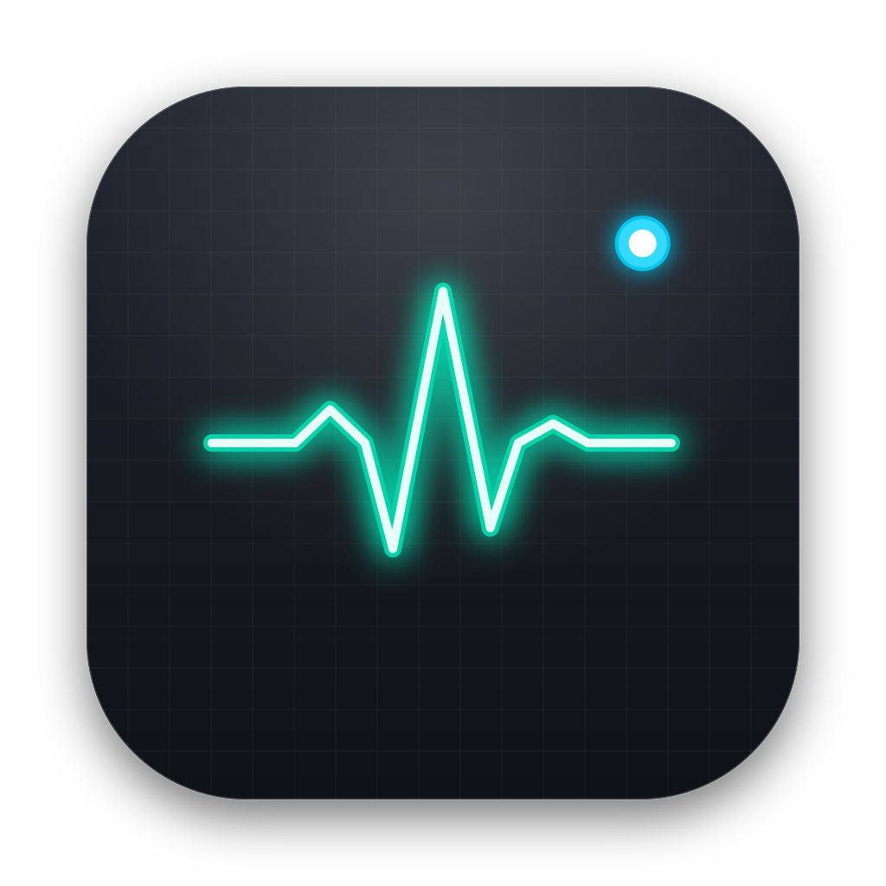

<p align="center">
  
</p>

<h1 align="center">MiniControl</h1>

<p align="center">
  <b>Ultra-lightweight native macOS menu bar system monitor and Intel Turbo Boost controller.</b><br>
  Engineered with pure Swift and AppKit for near-zero resource consumption.
</p>

<p align="center">
  
  
  
  
  
</p>

---

## Overview

**MiniControl** provides live hardware telemetry directly from your menu bar with minimal footprint. Unlike heavy web-wrapped status bar tools, MiniControl runs natively on Apple's Mach kernel and IOKit APIs, eliminating child processes, shell spawns, and unnecessary wakeups.

### Performance Benchmarks

| Metric | Target | Real-World Measurement |
| :--- | :--- | :--- |
| **RAM Footprint** | `< 15 MB` | **8 – 12 MB** (zero runtime memory leaks) |
| **CPU Usage** | `< 0.05%` | **~0.02%** average |
| **App Bundle Size** | `< 3 MB` | **~1.8 MB** (uncompressed binary) |
| **Sleep State** | Zero Wakeups | **0.00% CPU** (all timers paused on screen sleep) |

---

## Key Features

### 1. Heartbeat CPU Stress Indicator
* **Custom Vector Waveform**: Clean, pixel-perfect ECG heartbeat rendered dynamically via CoreGraphics.
* **3-Stage Stress Tinting**:
  * 🟢 **Green** (`< 50%` load): Nominal workload.
  * 🟡 **Yellow** (`50% – 79%` load): Moderate load.
  * 🔴 **Red** (`≥ 80%` load): High stress.
* **Mach Host API**: Direct delta calculation from `host_processor_info` (`PROCESSOR_CPU_LOAD_INFO`). No polling of `/bin/ps` or `top`.

### 2. Intel Turbo Boost Hardware Toggle
* **Hardware MSR Register Control**: Directly flips MSR `0x1A0` (`IA32_MISC_ENABLE` bit 38) to clamp clock speeds to base frequency, reducing thermal throttling and fan noise.
* **Menu Bar Status Dot**:
  * 🔵 **Solid Cyan Dot**: Turbo Boost **ON** (maximum boost frequencies unlocked).
  * ⚪ **Hollow Outline Ring**: Turbo Boost **OFF** (locked to base clock for power and thermal savings).
* **Instant Hotkey**: Toggle Turbo Boost state instantly via `Cmd+T`.
* **Max Clock Speed Display**: Context menu reveals live theoretical max clocks (e.g. `2.60 GHz Base Locked` vs. `4.50 GHz Turbo Active`).

### 3. Real-Time Charging & Battery Wattage Monitor
* **Event-Driven via IOKit**: Subscribes to `IOPSNotificationCreateRunLoopSource` from `AppleSmartBattery`. Consumes zero polling cycles when battery state is unchanged.
* **Live Power Metrics**:
  * Instantaneous charging rate (e.g., `+45.2W`).
  * Live battery discharge draw (e.g., `-12.5W (78%)`).
  * Connected AC adapter rated wattage (e.g., `65W`, `96W`, `140W`).
* **Optional Menu Bar Wattage Display**: Toggle numerical wattage readout directly beside the ECG heartbeat icon.

### 4. Zero-Power Sleep Awareness
* Listens to system display sleep events (`screensDidSleepNotification`).
* Automatically suspends polling timers while displays are dark, guaranteeing zero battery drain while sleeping.

---

## Menu Bar Anatomy

```
 [ ∿∿^∿∿ ] [ ● ]  [ +45.2W ]
     │       │         └── Optional live wattage readout
     │       └──────────── Turbo Boost indicator (Solid Cyan = ON / Ring = OFF)
     └──────────────────── Dynamic ECG Heartbeat (Green / Yellow / Red)
```

---

## System Requirements

* **Operating System**: macOS 13.0 (Ventura), macOS 14.0 (Sonoma), or macOS 15.0 (Sequoia).
* **Hardware**: Intel-based Mac (`x86_64`).
* **Root Helper**: Required only for hardware MSR access to toggle Intel Turbo Boost.

---

## Installation

### Pre-built Package
1. Download `MiniControl.dmg` from the latest [Releases](../../releases).
2. Open the disk image and drag **MiniControl.app** to `/Applications`.
3. Launch MiniControl from `/Applications` or Spotlight.

### Enable Turbo Boost Hardware Control (One-Time Setup)
macOS restricts direct writes to CPU Model Specific Registers (MSR) for security. To grant MiniControl permission to toggle Turbo Boost without prompting for root passwords on every click:

```bash
sudo make install-helper
```

This installs `/usr/local/bin/minicontrol-tb` and configures necessary root execution policies via `sudoers.d/minicontrol-tb`.

---

## Building from Source

MiniControl requires Xcode Command Line Tools or the full Xcode suite.

```bash
# Clone repository
git clone https://github.com/asyiraafnufail/mini-control.git
cd mini-control

# Compile and bundle MiniControl.app
make app

# Run application
make run

# Build distribution disk image (.dmg)
make dmg
```

---

## Project Structure

```
mini-control/
├── Package.swift                     # Swift Package Manager manifest
├── Makefile                          # Build automation and packaging targets
├── Resources/
│   ├── icon.svg                      # Vector branding icon
│   ├── AppIcon.icns                  # macOS application icon bundle
│   ├── Info.plist                    # Bundle metadata (LSUIElement=true)
│   └── DisableTurboBoost.kext        # Kernel extension for Intel MSR writes
├── scripts/
│   ├── generate_icon.swift           # Native CoreGraphics icon renderer
│   ├── install_helper.sh             # Privileged helper installer script
│   └── tb_toggle.sh                  # Hardware MSR / kext switch interface
└── Sources/
    └── MiniControl/
        ├── main.swift                # Application entrypoint
        ├── AppDelegate.swift         # Lifecycle & sleep/wake observers
        ├── Controllers/
        │   ├── StatusBarController.swift     # NSStatusItem & dynamic menu
        │   └── TurboBoostController.swift    # Intel MSR helper bridge
        ├── Monitors/
        │   ├── CPUMonitor.swift              # Mach kernel host CPU sampler
        │   └── PowerMonitor.swift            # IOKit AppleSmartBattery event monitor
        └── Views/
            ├── HeartbeatIcon.swift           # Vector ECG & status dot renderer
            └── CPUHistoryGraphView.swift     # Real-time sparkline graph view
```

---

## License

Distributed under the MIT License. See `LICENSE` for more information.
